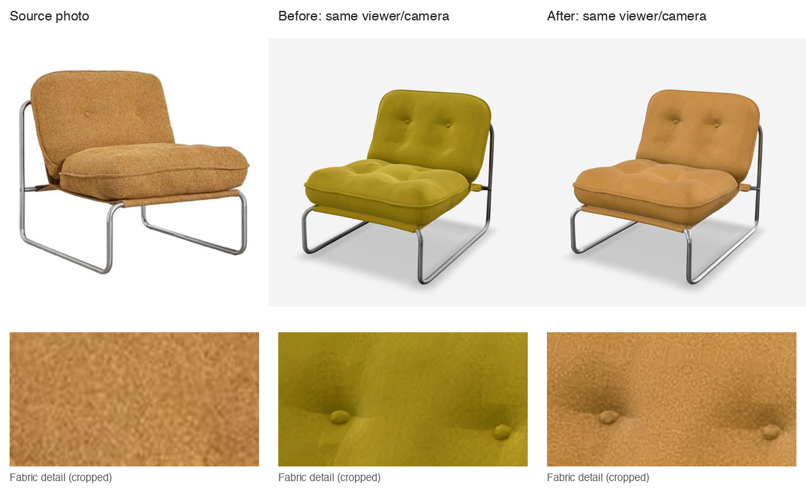

# Armchair material match

The reference is `apps/web/public/showcase/armchair.jpg`, the input photo identified by
`lib/showcase.ts` and the photo-to-model guide. `public/studio/photos/armchair.jpg` shows the
same photo cropped vertically. Neither photo was edited.

The showcase atlas had an olive cast and no metallic/roughness map, so the fabric inherited
the default metallic response. Its upholstery is now warm ochre and nonmetallic. Fabric detail
comes from a 135 × 85 pixel patch of the reference back cushion, with broad lighting removed,
mirrored at tile edges and blended through an upholstery mask. Existing seams and shading
remain. The steel stays neutral with a brushed response instead of tinting the entire object.
The four studio variants received equivalent edits in their own UV layout; their existing
normal maps remain intact. This is a local texture correction, not recovered geometry or new
views of the photographed chair.

| Public asset                       | Before bytes | After bytes | Use                                       |
| ---------------------------------- | -----------: | ----------: | ----------------------------------------- |
| `/showcase/armchair.glb`           |      551,068 |     622,804 | Learn, showcase, `/r/demo-armchair`       |
| `/studio/models/armchair.glb`      |      464,988 |     486,608 | Studio/home interactive scenes            |
| `/studio/models/armchair.hd.glb`   |      779,824 |     892,100 | Hub inspector and download                |
| `/studio/models/armchair.lod1.glb` |      155,700 |     142,920 | Hub cards and lower-detail scenes         |
| `/studio/models/armchair.lod2.glb` |       59,592 |      53,464 | Lowest-detail scenes                      |
| `/blog/models/armchair.webp`       |       33,982 |      60,744 | Learn poster, 960 × 960 with transparency |

`armchair.wire.glb` has no materials or textures and remains unchanged, as does the collider.
The angle sheet and its two blog crops are source illustrations, not model posters, and remain
unchanged. Studio thumbnails are rendered at runtime from the updated LODs. There are no
stored USDZ files: the public model view exports USDZ directly from the GLB. No renderer,
lighting, engine labels, other furniture or source photos changed.

## Evidence and checks

The ignored `.data/armchair-material-evidence/` folder contains the original GLBs, extracted
textures, source photo, private owner capture, before/after renders, contact sheets, USDZ
exports, editing/capture scripts and verification logs. The private capture is excluded from
this document's comparison and from git.

- Headless Chromium loaded all five textured variants before and after. The showcase was
  captured at `30deg 75deg auto` (the registered poster orbit), `-65deg 55deg auto`, and
  `180deg 75deg auto`. Every pair uses the same model-viewer 4.4.0 default environment,
  exposure 1, shadow intensity 1 and shadow softness 1, with rotation stopped.
- The studio models use `210deg 75deg auto` for the frontal comparison because their coordinate
  orientation differs. Additional before/after captures use the actual hub card renderer,
  environment and material finish code without modifications.
- The poster is a Chromium render at the registered orbit, with a transparent background,
  encoded to WebP. No photo retouching was applied to the poster or comparison renders.
- Geometry buffers (including compressed studio data), UVs, indices, accessors, node transforms
  and topology were compared against the originals and are byte-identical.
- Browser USDZ exports of the showcase and studio HD assets produced valid archives with
  connected base-colour, roughness and metallic textures. iPhone Quick Look was not tested.
- `python3 scripts/check-armchair-materials.py --asset-ref origin/main` reproduces the old
  olive upholstery and overly polished studio steel failures. The same check without
  `--asset-ref` passes for all updated assets. Requires Python, Pillow and NumPy; checks
  material colour, fabric detail, roughness, metalness, file size and poster dimensions/alpha.
- `bun run preflight` passes. Database integration tests retain their usual skip without a
  scratch database. No paid generation, credits, hosted mesh regeneration or deployment.

Finish condition: warm ochre upholstery with visible fabric detail and neutral brushed steel
in the existing viewers, all five public textured assets updated, original geometry preserved,
and poster/export outputs following the corrected material. The source photo and model still
differ in cushion shape because geometry was deliberately preserved.
